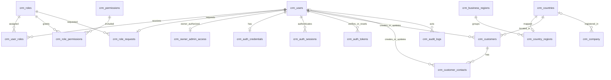

# Data model — Foundation V1

## Source of truth and database compatibility

The application schema is defined in [`migrations/001_crm_foundation.sql`](../migrations/001_crm_foundation.sql); [`scripts/migrate.ts`](../scripts/migrate.ts) records applied filenames and SHA-256 checksums in `crm_schema_migrations`. Add a new migration instead of editing an already-applied migration. DDL is not treated as atomically rollbackable: statements are rerunnable after a partial failure, and a migration is recorded only after its statements complete.

The observed managed engine is **`8.0.11-TiDB-v8.5.3-serverless`**, not an ordinary MySQL 8 server. The application uses `mysql2`, portable InnoDB table definitions, declared foreign keys/indexes and explicit application transactions. It does not rely on triggers, stored procedures or partial unique indexes. Revalidate SQL and driver behavior before moving to another MySQL-compatible engine/version.

All operational tables use the `crm_` prefix. **`crm_users` is the actual CRM identity/business-user table.** The starter's separate `users` table and Drizzle schema are legacy scaffolding, not the CRM identity source. Do not seed it to obtain access, or use the starter's OAuth helpers as the application's email/password API.

## Concise ERD

The diagram highlights primary business relationships; secondary actor foreign keys and the standalone migration, rate-limit and security-guard tables are described below.

## Tables and invariants

| Table                   | Purpose and important keys                                                                                                                                                                                                                                                                              |
| ----------------------- | ------------------------------------------------------------------------------------------------------------------------------------------------------------------------------------------------------------------------------------------------------------------------------------------------------- |
| `crm_users`             | Immutable UUID `id`; unique trimmed/lowercase `email_normalized`; full name, verification timestamp, approval status and one-time `bootstrap_completed` marker. Optional `updated_by` references another CRM user. Contains identity metadata, **not password hashes**.                                 |
| `crm_roles`             | Unique role `code` primary key; display name, `active` and `protected` flags, timestamps. Six seeded codes: `admin`, `ceo`, `pricing`, `sales`, `employee`, `technician`; displayed as Admin, CEO, Pricing, Sales Representative, Employee and Technician.                                              |
| `crm_permissions`       | Unique permission `code` primary key, display name and active flag. Only the thirteen current V1 permission codes are seeded.                                                                                                                                                                           |
| `crm_user_roles`        | Many-to-many assignments; composite primary key `(user_id, role_code)`, assignment timestamp and optional assigning actor. A user can hold multiple roles.                                                                                                                                              |
| `crm_role_permissions`  | Many-to-many grants; composite primary key `(role_code, permission_code)`. Link fields are foreign-keyed and indexed.                                                                                                                                                                                   |
| `crm_role_requests`     | One requested role per applicant, separate from granted assignments. `user_id` is the primary key; requested/reviewed timestamps and optional reviewing actor. Selecting a role at registration grants nothing.                                                                                         |
| `crm_auth_credentials`  | One salted scrypt password hash per user; password-change timestamp. Never expose this table to clients or include it in a default export.                                                                                                                                                              |
| `crm_auth_sessions`     | SHA-256 opaque session-token hash as primary key; user foreign key, CSRF hash and created/expiry timestamps. The raw session token lives only in the private cookie, not this table.                                                                                                                    |
| `crm_auth_tokens`       | SHA-256 single-use verification/reset token hash, user foreign key, purpose and expiry. No plaintext mail token is persisted.                                                                                                                                                                           |
| `crm_auth_rate_limits`  | Hashed operation/IP/email buckets with attempts and window start. No user foreign key; authentication throttling state, excluded from default exports.                                                                                                                                                  |
| `crm_company`           | Intended singleton `id = 1`, the Youcai General Information record. Optional company fields, country and updater references; neutral UTC/USD defaults. The service addresses row 1; the primary key alone does not prohibit another ID inserted outside the service.                                    |
| `crm_business_regions`  | Seven configurable region codes/names, active flag. This is business classification, not territorial pricing.                                                                                                                                                                                           |
| `crm_countries`         | ISO 3166-1 alpha-2 country-code primary key, name and active flag.                                                                                                                                                                                                                                      |
| `crm_country_regions`   | One configured region per country; `country_code` primary key, country/region foreign keys, update timestamp and optional updater. Customers derive their region through this mapping rather than storing a pricing rule.                                                                               |
| `crm_customers`         | Immutable UUID; required display name, customer type and country. Separate optional legal-entity type and conditional legal name. Optional contact/address/tax/notes fields; ACTIVE/ARCHIVED status; timestamps and required creating/updating CRM users. Names and emails are indexed, **not unique**. |
| `crm_customer_contacts` | Immutable UUID and customer foreign key; name, optional salutation/alias/title/phone/email and primary flag; timestamps/actors. Many contacts are allowed per customer.                                                                                                                                 |
| `crm_audit_logs`        | Immutable UUID, optional actor, action/entity identifiers, allowlisted service metadata JSON and creation time. Indexed by time, actor and entity; not a password/token or unrestricted request-body log.                                                                                               |
| `crm_security_guard`    | Singleton row `id = 1` locked by security-sensitive transactions to serialize administrator/permission/bootstrap changes. No login or business identity.                                                                                                                                                |
| `crm_schema_migrations` | Migration filename primary key, SHA-256 source checksum and application timestamp. Created by the migration runner, not the initial SQL file.                                                                                                                                                           |

### Authorization and account state

Statuses are `UNVERIFIED`, `PENDING_APPROVAL`, `ACTIVE`, `REJECTED` and `SUSPENDED`. Business access requires **both** ACTIVE status and a verified email. For each request the backend reloads assigned active roles and active permissions; effective permissions are their union, not a role claim cached in a cookie. General Settings additionally requires actual Admin/CEO role membership.

The exact bootstrap email allowlist is implemented in `server/crm/security.ts`. Email ownership must first be proven through the verification flow; merely entering an allowlisted email or sharing its domain is not sufficient. A persisted completion marker makes bootstrap one-time/idempotent rather than continually overriding later administrator decisions. Administrator changes protect against self-role/status changes, unverified approval and loss of the last effective active top-level administrator. Core Admin/CEO permissions cannot be removed through permission administration.

### Customer and contact rules

Customer type and legal-entity type are independent validated dimensions, not duplicate labels. `country_code` is an ISO country, while region is derived through `crm_country_regions`. Turkey (`TR`) and Egypt (`EG`) remain countries. A customer is a buyer/company/practitioner, **not** a CRM login identity; there is no customer self-service portal.

The maximum-one-primary-contact rule is enforced **transactionally in the business service**, by locking the parent customer and updating primary flags in the same transaction. The `(customer_id, is_primary)` index is nonunique and is not itself a uniqueness constraint. Direct writes outside that service could violate the rule and must not be used for normal administration or an unreviewed restore. Archive customers instead of permanently deleting them; contact deletion, where supported, is separately authorized and audited.

Conditional legal-name requirements, permitted status/type codes, singleton use, audit metadata selection and the administrator invariant are application rules; foreign keys alone do not enforce them. Keep restored writes behind the same validation/transaction rules, and validate these invariants before reopening a recovered application.

## Seeds, excluded scope and backup implications

The seed script inserts missing reference rows and initial role defaults while preserving existing permission assignments, country-region mappings and company edits on reruns. It creates **no user, credential, active administrator, customer or test contact**. Do not use rerunning a seed as a way to reset security policy. The blank company row uses only neutral currency/timezone defaults, not invented legal information.

There are **no Products, prices, quotes, inventory, technical-document, workflow or SSO tables** in Foundation V1. Future permission names are documentation reservations only, not implemented APIs or seeded product grants.

The default [manual export](operations.md#database-export-and-recovery) retains CRM identity metadata and actor/role foreign keys but excludes credential/session/token/rate-limit tables. It therefore preserves business relationships while deliberately omitting the ability to sign in from the export alone. A full credential-bearing export requires explicit authorization and external encryption; every restored deployment must invalidate sessions and single-use tokens. The legacy starter `users` and unknown future tables are deliberately omitted until separately reviewed.

## Owner-provisioned administrator access

Additive migration 002_owner_admin_access.sql introduces crm_owner_admin_access, keyed by the immutable user UUID with authorization and password-setup completion timestamps. It is distinct from email_verified_at: an owner-provisioned account can have authorized Active/Admin access while its emailVerified flag remains false. Only exact five designated emails with completed owner authorization qualify; a public role request or email string never creates this proof. Private ADMIN_SETUP tokens reuse the hashed/expiring auth-token table, are consumed once and excluded from default backups with other tokens. Backup business metadata now includes the reviewed owner-authorization table; restore still requires an independently approved credential-recovery process. No applied migration was edited and no startup seed creates these identities.
